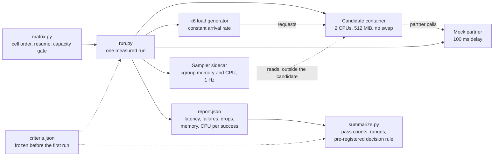
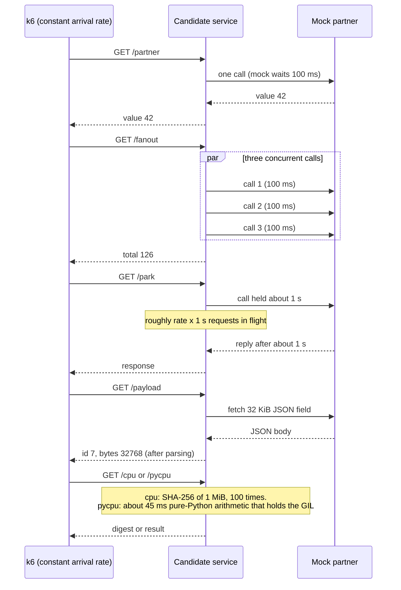
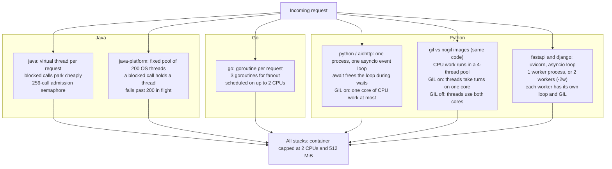
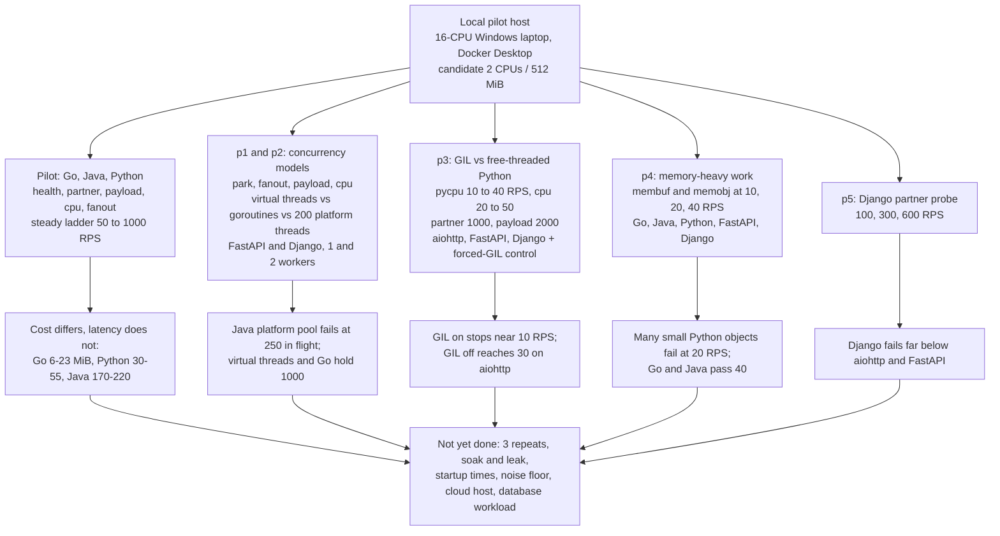
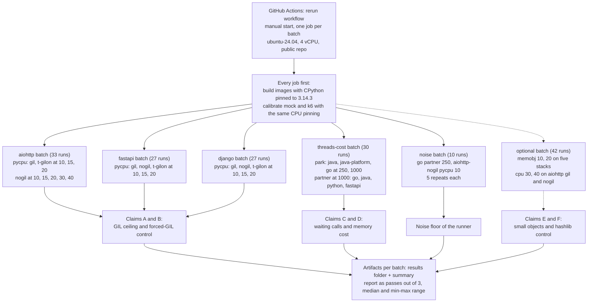

# Java / Go / Python service benchmarking

Runnable baseline for a hotel PMS channel connector or payment-provider adapter.
This measures these implementations and dependencies, not a universal language ranking.
No benchmark measurements have been invented. No real payment credentials or systems are used.

## Install in the requested Windows directory

Extract this project's contents into:
`C:\personal\arun\workspace\language-benchmarking`

Prerequisites: Docker Desktop using **Linux containers**, Python 3.10+ on the host,
and PowerShell. Allocate at least 6 CPU cores and 6 GiB to Docker for local pilot
runs. Internet access is required for the first image/dependency build.

```powershell
cd C:\personal\arun\workspace\language-benchmarking
powershell -ExecutionPolicy Bypass -File .\setup.ps1
# Quick validation only: not publication-quality performance data.
python scripts/run.py --language java --rate 10 --duration 15s --warmup 10s --idle 2 --recovery 2
python scripts/run.py --language go --rate 10 --duration 15s --warmup 10s --idle 2 --recovery 2
python scripts/run.py --language python --rate 10 --duration 15s --warmup 10s --idle 2 --recovery 2
# Representative measured run: default idle 2m, warmup 5m, measured 5m, recovery 5m.
python scripts/run.py --language java --endpoint fanout --rate 500
# Repeat for go and python, rotating order.
python scripts/run.py --language go --endpoint partner --profile stress --rate 100
python scripts/run.py --language python --endpoint partner --profile spike --rate 100
python scripts/run.py --language java --endpoint partner --profile soak --rate 500
# Calibrate mock + generator once (writes results/calibration.json; needed above 300 RPS).
python scripts/calibrate.py
# Cold start, noise floor, then a coarse matrix pass before spending days on the full one.
python scripts/startup.py --language go
python scripts/noise.py --language go --endpoint partner --rate 250
python scripts/matrix.py --pass coarse
python scripts/matrix.py --pass dense      # ladder rates around the knee, 3 repeats
# Full steady matrix is ~216 runs (about 60 hours). Resumable; failed cells are logged, not fatal.
python scripts/matrix.py --pass full --repeats 3
# Tables and the pre-registered decision rule (edit criteria.json BEFORE the first measured run).
python scripts/summarize.py
```

On Linux, replace setup.ps1 with `docker build -t lb-python python`, then the
corresponding java/go commands and `docker pull grafana/k6:1.3.0`.

## What is being compared

| Candidate | Implementation | Execution model |
|---|---|---|
| Java 25 | JDK HttpServer, HttpClient, Jackson | Virtual thread per request; verified by /meta |
| Go 1.25 | Standard net/http and encoding/json | Goroutine handlers; three goroutines for fanout |
| CPython 3.14 | aiohttp, one process | One asyncio event loop, default GIL build |

Versioned images and dependencies are in Dockerfiles and manifests. This is an
explicit reproducible baseline, not a claim these versions are the newest. Record
image IDs/digests and use digest pins before publication. Python is not running
one OS thread per request; its async tasks are a different concurrency mechanism.
The CPU handler intentionally runs synchronously; in Python it stalls the event
loop. hashlib's native code may release the GIL, but that does not make a single
async event loop run other coroutines while this handler executes.

## Equivalent workloads

| Endpoint | Work and exact response contract |
|---|---|
| /health | Small JSON `{ "ok": true }` |
| /partner | One mock HTTP call, 100 ms delay; `{ "value": 42 }` |
| /fanout | Three concurrent 100 ms partner calls; `{ "total": 126 }` |
| /payload | Parse identical mock JSON containing a 32 KiB ASCII **field**; `{ "id": 7, "bytes": 32768 }` |
| /cpu | SHA-256 same 1 MiB of ASCII `a`, 100 independent hashes; return final hex digest |

The entire JSON body on /data is slightly larger than 32 KiB. SHA-256 is a
native/library-heavy control case; do not call this a pure language interpreter
benchmark. Frameworks add different overhead; report stack names in results.
All services use HTTP/1.1 reuse, no request access logs, no TLS/compression and a
256 outbound connection/inflight-call limit. Go/aiohttp enforce connection-pool
limits; Java uses an admission semaphore, which is similar but not identical.
Timeouts approximate three seconds, with implementation-dependent queue timing.
Avoid using saturated pool/failure behavior as a clean runtime comparison.

## Files and output

- `TEST_PLAN.md`: methodology, fairness controls, phases, acceptance rules.
- `scripts/run.py`: lifecycle, contract validation, k6 run, 1-second sampler, report.
- `scripts/matrix.py`: full/coarse/dense matrix, Latin-square order, resumable, capacity-gated.
- `scripts/calibrate.py`, `scripts/startup.py`, `scripts/noise.py`, `scripts/summarize.py`: mock/generator calibration, cold start, noise floor, aggregation and decision rule.
- `scripts/sampler.py`, `scripts/analysis.py`: out-of-candidate cgroup sampler; memory phase, leak and recovery analysis.
- `criteria.json`: pre-registered SLO, weights, thresholds.
- `load/test.js`: constant-arrival, stress ramp, spike and soak profiles.
- `tests/contract.py`: exact correctness checks, 404 and Java virtual-thread check.
- `results/<run>/resources.csv`: timestamp, phase, container memory, PID-1 RSS,
  cumulative CPU, throttling, OOM counts and OS threads.
- `report.json`: latency/throughput/error/drop metrics, memory median/sample peak,
  CPU ms per success. `metadata.json` records limits, image and host information.
- `load.log`, `candidate.log`, `mock.log`: diagnostics; warmup has separate output.

The runner requires Linux **cgroup v2** (the sampler sidecar mounts the Docker host's /sys/fs/cgroup read-only); the default sampler needs no shell inside the candidate image.
Sampler failures are recorded; any such errors invalidate resource comparisons.
CPU counters are the first and last 1 Hz samples of the measured phase, which also span
load-generator container startup and teardown. The interval is consequently slightly wider than actual requests;
for five-minute runs this is generally small, but report that limitation.
Memory peak is a one-second sampled peak and may miss shorter bursts.
Contract checks happen before idle, so this idle is post-correctness-check idle,
not pristine cold-process idle.

## What this first suite does not establish

No Spring Boot/Django production-stack comparison, database benchmark, financial
ledger correctness proof, tenant-isolation test or manual-effort percentage.
Add matched PostgreSQL/transaction and framework variants as a separate series.
Python multiworker/free-threaded variants, Java native image and runtime tuning
must be separate, explicitly labeled experiments with the same aggregate limits.
For strict whole-system concurrency limits, add identical application admission
and cancellation behavior before comparing overload responses.

See VALIDATION.md for checks executed when this package was created.

## Extended campaigns (added after the first pilot)
- Candidate groups (`matrix.py --group`): `core`, `python`, `threads` (virtual vs platform threads vs goroutines), `gil` (aiohttp/FastAPI/Django on CPython 3.14 with the GIL and free-threaded without it, plus the `aiohttp-t-gilon` control) and `mem`.
- New endpoints: `/park` (partner holds the call about 1 s), `/pycpu` (pure-Python CPU work, holds the GIL), `/membuf` (allocate and touch 16 MiB), `/memobj` (build 50,000 records).
- `gil/` holds the images `lb-gil` (PYVER=3.14) and `lb-nogil` (PYVER=3.14t). `--fast` shortens timings to about 7 minutes per run; `--tag` names a campaign and makes the run resumable.
- Drivers: `scripts/phase1.ps1`, `phase2.ps1`, `phase3.ps1` (GIL and memory). Reports: `python scripts/report_html.py` builds `results/report.html`. Results and caveats: FINDINGS.md; other angles: PERSPECTIVES.md.

## Test map: what ran locally and what runs on the cloud VM

The diagrams are Mermaid, which GitHub renders in this file. The cloud rerun plan, scripts and
workflow are in [`rerun/`](rerun/RERUN_PLAN.md) and [`.github/workflows/rerun.yml`](.github/workflows/rerun.yml).

### How one measured run works (same on both)



### Request flow per endpoint



### How each stack runs a request (threads and tasks)



### Already run: local pilot (Windows laptop, Docker Desktop, 1 repeat per cell)

Single-repeat runs, mostly `--fast` (about 7 minutes each). Results are directional only; see FINDINGS.md.



### To run: cloud rerun (GitHub Actions, 4 vCPU Linux, 3 repeats, `--fast`)

Each batch is one job on one runner, so every comparison stays on the same machine. The candidate
is pinned to CPUs 0 and 1, and the mock, k6 and sampler to CPUs 2 and 3.



Cells whose offered load would exceed the calibrated mock and generator capacity are skipped and
logged in `results/matrix_skipped.log`. On a 4 vCPU runner the 1000 RPS cells may be skipped.
